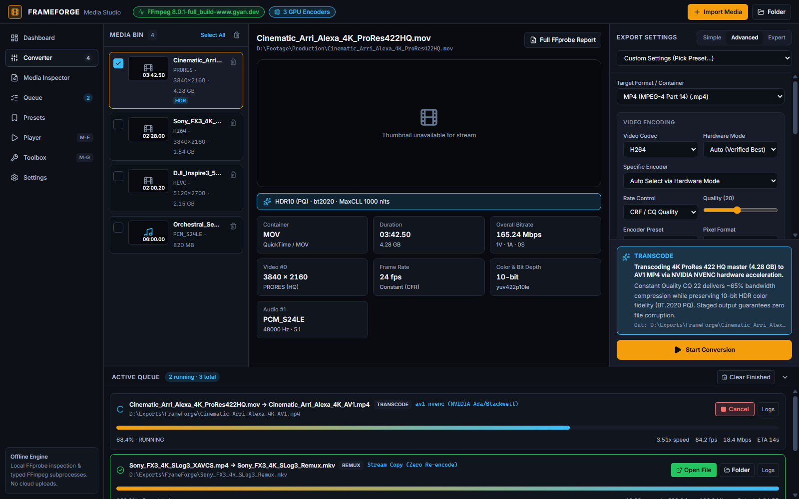
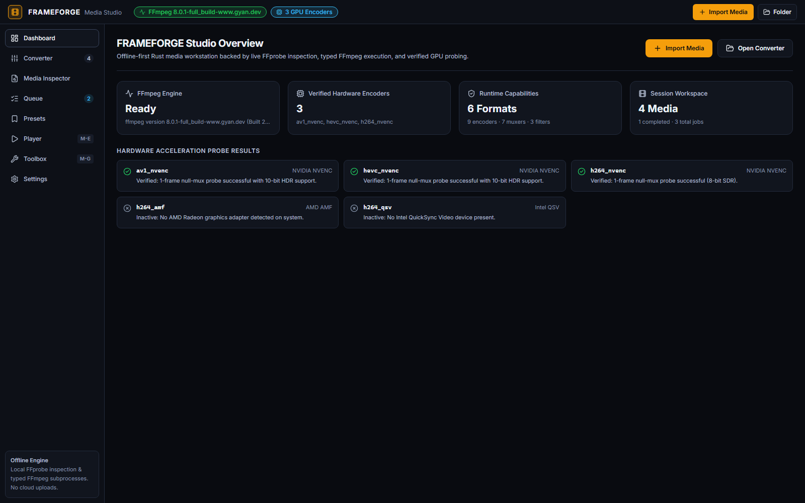
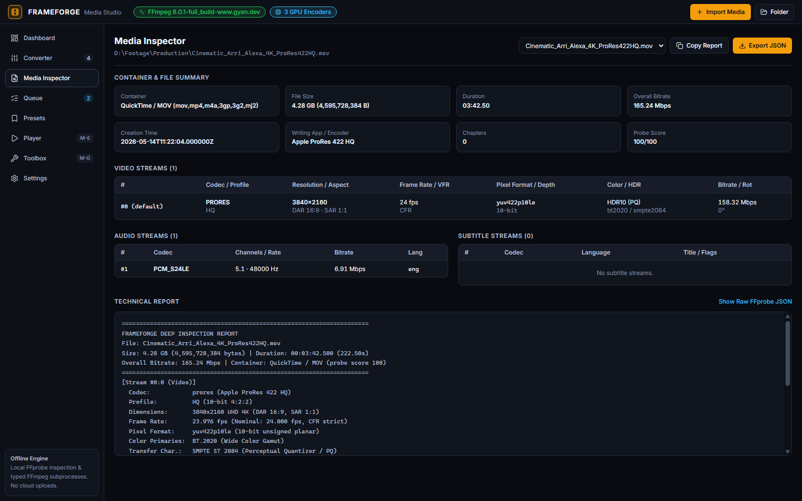
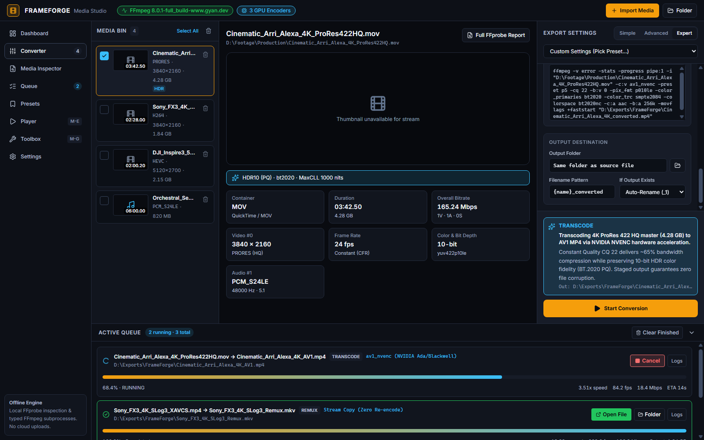
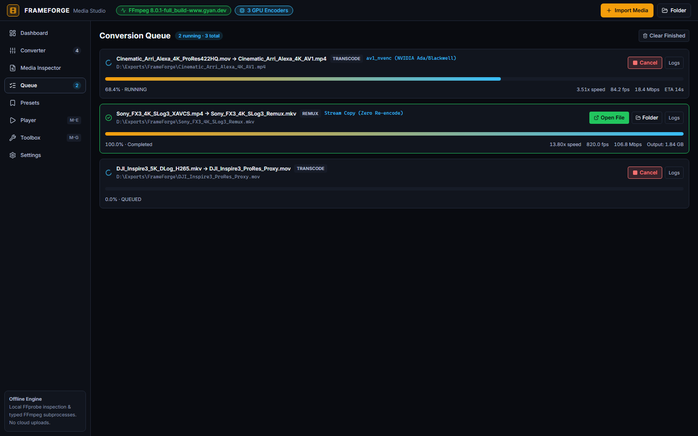
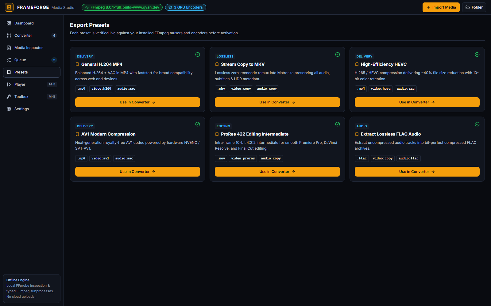
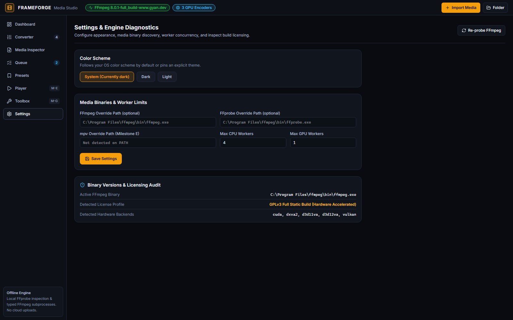

# FRAMEFORGE

**Offline-first desktop media conversion, inspection, and utility studio** powered by **Rust**, **Tauri 2**, **React + TypeScript**, **FFmpeg**, and **FFprobe**.

FRAMEFORGE separates heavy media orchestration into a strict, panic-free Rust engine (`crates/frameforge-core`), exposes typed IPC commands via a thin Tauri 2 shell (`src-tauri`), and keeps the React frontend (`src`) purely as a responsive presentation layer.

> **Status**: Milestones **A, B, and C** are implemented and tested (Windows-first, with cross-platform abstractions prepared for Linux and macOS). Milestones **D–H** are tracked on the roadmap below.

---

## Visual Studio Tour & Screenshots

| Workspace View | Description |
| --- | --- |
| [**Converter Studio**](#1-universal-converter-workspace) | Multi-clip media bin, 4K preview stage, real-time decision engine, and live progress dock |
| [**Studio Overview**](#2-studio-overview--hardware-acceleration-diagnostics) | Live FFmpeg capabilities, 1-frame GPU probe telemetry, and active worker stats |
| [**Deep Media Inspector**](#3-deep-ffprobe-media-inspector) | Stream-by-stream container analysis, HDR10 MaxCLL metadata, and exportable reports |
| [**Expert Parameter Controls**](#4-expert-parameter-controls--validated-command-preview) | Zero-shell token-validated options with live syntax-highlighted command preview |
| [**Batch Transcoding Queue**](#5-real-time-job-queue--bounded-hardware-scheduling) | Bounded CPU/GPU semaphores, live ETA / speed multiplier, and atomic staging |
| [**Preset Catalog**](#6-verified-built-in-export-presets) | 1-click delivery, lossless remux, ProRes/DNxHR intermediate, and archival presets |
| [**Settings & Diagnostics**](#7-settings--binary-discovery) | Binary discovery overrides, 3-state dark/light theme, and worker concurrency limits |

---

### 1. Universal Converter Workspace
> Multi-clip media bin with drag-and-drop import, rich stream summaries (4K UHD, HDR10 PQ, 10-bit 4:2:2, 5.1 Surround), real-time quality decision banner (`COPY`, `REMUX`, `TRANSCODE`), and live transcoding dock.



---

### 2. Studio Overview & Hardware Acceleration Diagnostics
> Instant diagnostic dashboard probing the local FFmpeg engine, 1-frame null-mux verified GPU hardware encoders (NVIDIA NVENC AV1/HEVC/H264, AMD AMF, Intel QSV), format multiplexers, and system session stats.



---

### 3. Deep FFprobe Media Inspector
> Full container, video, audio, and subtitle stream telemetry: container probe score, DAR/SAR, constant vs. variable frame rate (VFR) detection, color primaries (BT.2020), mastering display luminance, MaxCLL/MaxFALL, and copyable technical ASCII reports.



---

### 4. Expert Parameter Controls & Validated Command Preview
> Three interface tiers (`Simple`, `Advanced`, `Expert`). Expert mode validates arguments strictly into typed `Vec<OsString>` tokens with zero OS shell interpolation and renders a real-time command preview.



---

### 5. Real-Time Job Queue & Bounded Hardware Scheduling
> Real-time conversion tracking parsing `-progress pipe:1` metrics (`%`, `FPS`, `speed ratio`, `bitrate`, `ETA`). Enforces strict bounded concurrency semaphores to protect system responsiveness, backed by atomic staged file writes.



---

### 6. Verified Built-In Export Presets
> Curated presets checked dynamically against installed FFmpeg muxers and encoders at startup: Universal Delivery (`H.264`, `HEVC`, `AV1`), Lossless Remux (`Stream Copy to MKV`), Editing Intermediate (`Apple ProRes 422`, `Avid DNxHR HQ`), and Archival (`Lossless FFV1`, `FLAC`).



---

### 7. Settings & Binary Discovery
> Runtime binary path discovery and overrides for `ffmpeg`, `ffprobe`, and `mpv`, CPU/GPU worker limits, licensing profile audits, and explicit System / Dark / Light theme preferences.



---

## Core Design Principles

- **Zero Shell Interpolation**: Builds typed `Vec<OsString>` argument lists for `ffmpeg` and `ffprobe`; expert options are token-validated and never executed through an OS shell.
- **No Unverified Capability Claims**: Inspects `-demuxers`, `-muxers`, `-decoders`, `-encoders`, `-filters`, and `-hwaccels` at startup and executes real 1-frame null-mux probes before advertising GPU hardware encoders.
- **Stream Copy When Possible, Transparent When Not**: Every job is analyzed upfront (`COPY`, `REMUX`, `TRANSCODE`, or `FAIL`) with explicit explanations of quality impact.
- **Atomic Output Safety**: Transcodes write to uniquely named staged files (`StagedOutput`) in the destination directory and rename atomically only upon clean completion—never corrupting existing media on failure or cancellation.
- **Bounded Concurrency & Async Discipline**: Separate CPU/GPU semaphore limits, `.kill_on_drop(true)` subprocess management, bounded stderr ring buffers, and blocking filesystem operations kept off async executor threads.

---

## Implemented Features (Milestones A–C)

### Desktop Workspace (`src/`, `src-tauri/`)
- Native **Tauri 2** desktop window with drag-and-drop import, native file/folder pickers, and System / Dark / Light themes.
- Organized workspace views: **Dashboard**, **Converter**, **Media Inspector**, **Queue**, **Presets**, and **Settings** (plus roadmap previews for **Player** and **Toolbox**).
- Live backend-to-frontend telemetry over `frameforge://` events backed by **Zustand**.

### Real FFprobe Media Inspector (`media/`)
- Asynchronous content probing via `ffprobe` (`-protocol_whitelist file,pipe`), safe with Unicode paths and spaces, with clear diagnostics for corrupt, empty, or encrypted inputs.
- Locates primary video streams accurately without assuming stream index `0`.
- Inspects container format, duration, resolution, DAR/SAR, nominal vs. average FPS & VFR detection, bit depth, pixel format, color primaries/transfer characteristics, HDR metadata (PQ/HLG, Mastering Display, MaxCLL), rotation (display matrix or stream tags), encoder tags, creation time, and multi-track video/audio/subtitle metadata.
- Exports copyable ASCII technical reports and raw FFprobe JSON, plus locally cached `480px`-wide JPEG keyframe thumbnails.

### Universal Converter & Presets (`conversion/`, `hardware/`, `jobs/`, `storage/`)
- **Three Interface Levels**:
  - **Simple**: Output format, quality target, destination, and preset selection.
  - **Advanced**: Codecs, CRF/CQ or bitrate control, resolution, frame rate, GOP size, pixel format, audio mode/codec/bitrate, subtitle handling, and hardware acceleration mode.
  - **Expert**: Token-validated extra FFmpeg parameters paired with a live command preview.
- **Container & Codec Matrix**: `MP4`, `MKV`, `MOV`, `WebM`, `AVI`, `MPEG-TS`, `M4A`, `FLAC`, `WAV`, and `MP3`, filtered dynamically against installed FFmpeg muxers and encoders.
- **Built-in Presets**:
  - *Delivery & Compression*: `General H.264 MP4`, `Stream Copy to MKV`, `High-Efficiency HEVC`, `AV1 Modern Compression`, `Web / YouTube 1080p`
  - *Editing, Archival & Audio*: `ProRes 422 Editing Intermediate`, `DNxHR HQ Editing Intermediate`, `Lossless FFV1 Archival`, `720p H.264 Editing Proxy`, `Extract Lossless FLAC Audio`
- **Hardware Acceleration Verification**: Probes candidate `NVENC`, `QSV`, `AMF`, and `MediaFoundation` encoders with `Auto`, `Cpu`, `Gpu`, `QualityPriority`, and `SpeedPriority` modes plus configurable explicit CPU fallback.
- **Progress, Disk Checks & Cancellation**: Parses `-progress pipe:1` metrics (`percent`, `fps`, `speed`, `bitrate`, `ETA`), checks available destination disk space on Windows (`GetDiskFreeSpaceExW`), supports cooperative cancellation (`q` signal + process termination + staged temp cleanup), and opens/reveals finished outputs.

---

## Tech Stack

| Layer | Technologies |
| --- | --- |
| **Desktop Runtime** | Tauri 2 |
| **Core Engine** | Rust (Edition 2024, MSRV 1.90+), Tokio, Serde, `thiserror`, `tracing`, `chrono`, `uuid` |
| **Media Backend** | Subprocess `FFmpeg` & `FFprobe` |
| **Frontend UI** | React 19, TypeScript, Vite, Tailwind CSS v4, Zustand, Lucide React |
| **Testing & Linting** | Cargo `clippy` (pedantic + panic-free lints), `rustfmt`, integration tests against real FFmpeg, Vitest + Testing Library |

---

## Architecture & Repository Layout

```text
.
├── Cargo.toml                  # Workspace definition & strict Clippy/Rust lints
├── crates/frameforge-core/     # Pure Rust media & job orchestration library
│   ├── src/
│   │   ├── core/               # Errors, config, shared IPC models, event stream
│   │   ├── media/              # FFprobe inspection, capabilities, formats, thumbnails
│   │   ├── hardware/           # 1-frame GPU probing, encoder selection & fallback
│   │   ├── conversion/         # Decision analyzer, typed command builder, transcoder
│   │   ├── jobs/               # Bounded scheduler, queue, progress parser, cancel tokens
│   │   ├── storage/            # Staged atomic outputs, collision handling, thumbnail cache
│   │   ├── platform/           # Windows (CREATE_NO_WINDOW, Win32 disk check), Linux/macOS
│   │   ├── playback/           # Domain boundaries prepared for Milestone E (mpv/libmpv)
│   │   └── editing/            # Domain boundaries prepared for Milestone G (Toolbox)
│   └── tests/                  # Real FFmpeg/FFprobe integration tests
├── src-tauri/                  # Tauri 2 desktop binary & typed IPC command bridge
├── src/                        # React + TypeScript presentation layer
│   ├── features/               # converter, inspector, queue, presets, settings, shared
│   ├── store/                  # Zustand state & Tauri event bindings
│   └── lib/                    # Typed IPC wrappers & formatters
└── docs/
    ├── ARCHITECTURE.md         # Module-by-module design reference
    └── LICENSING.md            # FFmpeg/mpv bundling & redistribution checklist
```

See [docs/ARCHITECTURE.md](docs/ARCHITECTURE.md) for a deeper breakdown of every module and IPC boundary.

---

## Prerequisites

- **Rust**: `rustup` stable toolchain (**MSRV 1.90+**)
- **Node.js**: `20+` and `npm`
- **FFmpeg & FFprobe**: Available on `PATH`, or configured in the app's **Settings** view
- **Windows Toolchain Note**:
  - **MSVC (`stable-x86_64-pc-windows-msvc` + Visual Studio C++ Build Tools)**: builds directly in-place.
  - **MinGW GNU (`stable-x86_64-pc-windows-gnu` + MinGW-w64 `gcc`/`windres`)**: if your checkout path contains spaces, point `CARGO_TARGET_DIR` to a space-free folder (e.g., `$env:LOCALAPPDATA\frameforge-target`) so GNU `windres` resolves resource includes cleanly.

---

## Development, Testing & Build

Install Node dependencies:

```powershell
npm install
```

Run frontend unit & component tests and build the frontend bundle:

```powershell
npm test
npm run build
```

Run formatting, strict workspace Clippy lints, and Rust integration tests (uses real `ffmpeg`/`ffprobe` on `PATH`):

```powershell
# Example shown with MSVC; with MinGW GNU set CARGO_TARGET_DIR and pass +stable-x86_64-pc-windows-gnu
cargo fmt --all -- --check
cargo clippy --workspace --all-targets -- -D warnings
cargo test --workspace -- --nocapture
```

Launch the desktop app in development mode or build a release binary:

```powershell
# MinGW GNU in a space-containing folder:
$env:CARGO_TARGET_DIR = "$env:LOCALAPPDATA\frameforge-target"

npx tauri dev -- --toolchain stable-x86_64-pc-windows-gnu

# Release standalone binary (embeds built `dist/` bundle via `custom-protocol`):
npm run build
cargo +stable-x86_64-pc-windows-gnu build -p frameforge --release --features custom-protocol

# Or create an installer bundle via Tauri CLI:
npx tauri build -- --toolchain stable-x86_64-pc-windows-gnu
```

---

## Roadmap (Milestones D–H)

- **Milestone D**: SQLite persistent job history, crash-safe restart recovery, and queued retries (`jobs/persistence`, `storage/history`).
- **Milestone E**: Dedicated universal media playback via `mpv`/`libmpv` (`playback/`).
- **Milestone F**: GPU filter pipelines and representative clip encoder benchmarking (`hardware/benchmark`).
- **Milestone G**: Non-destructive Editor Toolbox (trim, concatenate, crop, rotate, speed, loudness normalization, GIF/image sequences, proxies) (`editing/`).
- **Milestone H**: Production installers, binary compliance packaging, and extended HDR/10-bit/VFR verification matrices.

---

## Licensing

- **FRAMEFORGE source code** (`crates/frameforge-core`, `src-tauri`, `src`) is licensed under the [MIT License](LICENSE).
- **External media tools (`FFmpeg`, `FFprobe`, planned `mpv/libmpv`)** carry their own licenses (typically **GPLv3** or **LGPLv2.1+** depending on build configuration). Before packaging or redistributing FFmpeg binaries alongside FRAMEFORGE, review the obligations and checklist in [docs/LICENSING.md](docs/LICENSING.md).
